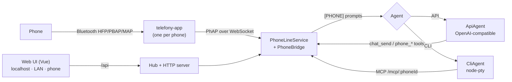

# Timbre

AI phone manager. Timbre puts an LLM on a real phone: it answers calls and SMS, places calls through a call agent, and texts you a summary of each call. Each phone runs through [telefony-app](https://github.com/PetePeter/telefony-app), which makes the PC act as a Bluetooth hands-free kit and talks to Timbre over [PhAP](https://github.com/PetePeter/phone-agent-protocol).

- **One phone by default.** You can add more; each phone gets its own telefony-app process and port.
- **Two kinds of LLM.** An **API model** is any OpenAI-compatible endpoint. A **CLI in a terminal** (Claude Code, Codex, …) runs in a PTY and acts through Timbre's MCP endpoint.
- **One web UI** works on the desktop browser, on other PCs and on phones.



## Run

```bash
npm install
npm start          # build + serve on http://localhost:7790
npm test           # Vitest
npm run dev        # Vite dev server for the UI (proxies /api to :7790)
```

| Script | Purpose |
|--------|---------|
| `python run.py` | Install deps if the lockfile changed, build, run |
| `python publish.py [patch\|minor\|major]` | Bump version, test, build, zip to `release/`, commit, tag, push, GitHub release |

Settings are stored in `timbre.yaml` in a per-user folder, never in the repo:

| OS | Folder |
|----|--------|
| Windows | `%APPDATA%\Timbre` |
| macOS | `~/Library/Application Support/Timbre` |
| Linux | `$XDG_CONFIG_HOME/timbre` |

Set `TIMBRE_HOME` to use a different folder.

## Setting up a phone

1. Install telefony-app and its Bluetooth dongle (see its SETUP.md).
2. In **Phones → Settings**, set the executable and the Bluetooth transport, add yourself as the **Owner** contact, then switch the phone **On**.
3. In **LLMs**, configure the model that answers the phone, then pick it under **Answered by**.

### CLI LLMs

The CLI is started with its arguments, after two placeholders are filled in:

- `{mcpConfig}` is the path to a generated MCP config file that holds the URL and the per-phone bearer token. For Claude Code, use `--mcp-config {mcpConfig}`.
- `{mcpUrl}` is the MCP URL on its own.

The CLI also gets `TIMBRE_MCP_URL` and `TIMBRE_MCP_TOKEN` as environment variables.

## Security

- **Who can open the UI:** localhost is always trusted. With **LAN access** on, Timbre listens on every interface and any other device needs the token. Open the access link (`/?token=…`) once and the token is stored in an HttpOnly cookie.
- **Cross-site writes:** a write from another origin is refused.
- **MCP tokens:** every phone has its own token, created fresh at each start. A token only works for its own phone.
- **Untrusted text:** caller speech and SMS bodies are passed to the LLM as quoted data, never as instructions. This rule comes from the ported PhoneBridge.

## macOS

The server, the UI and node-pty all run on macOS. telefony-app is built on Google's Bumble, which supports USB dongles on macOS as an experimental feature:

```bash
sudo nvram bluetoothHostControllerSwitchBehavior="never"
```

That command stops macOS from claiming the dongle. telefony-app currently ships Windows builds only, so on a Mac you would run it from source. Windows SAPI voices are not available on a Mac; use Piper instead.

## Origin

`src/phone/*` and `src/session/*` were ported from Helm's `feat/phapsupport` branch (P-1091 to P-1096).
