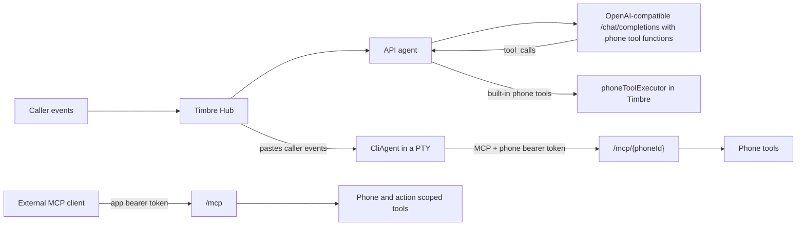
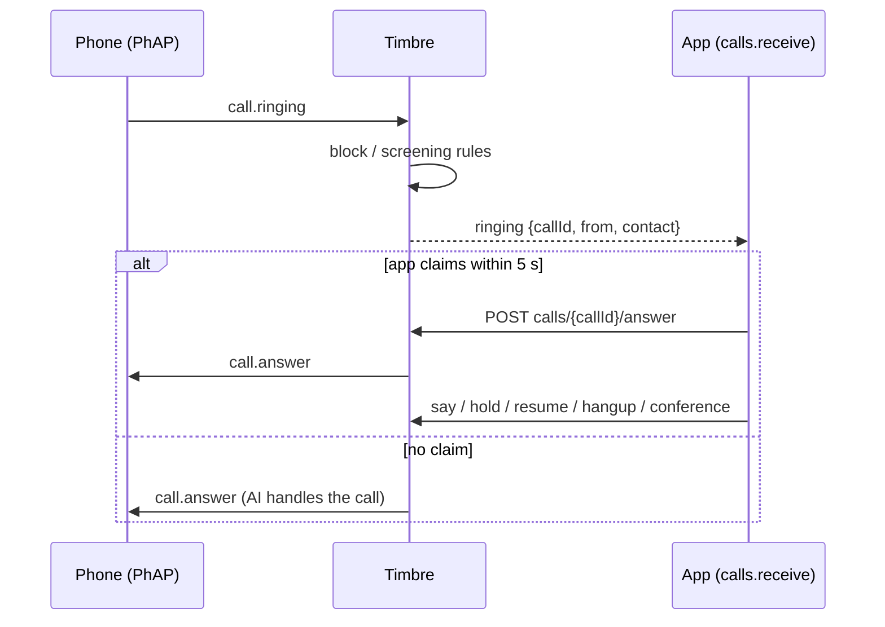

# How agents talk to Timbre

Each phone uses one configured agent. Caller events go through the Hub to that agent; the return path depends on the agent type.

## OpenAI-compatible API model

1. In **Agent**, add or choose an API model and enter its OpenAI-compatible base URL, model, and optional API key.
2. Assign the model to a phone and save. Timbre offers that mode's phone tools as function definitions and executes built-in tool calls in-process.

## Claude Code or another CLI

1. In **Agent**, choose the Claude Code preset or configure a CLI command and arguments.
2. For a custom CLI, put `{mcpConfig}` or `{mcpUrl}` in its arguments. At launch Timbre fills the placeholders and writes a per-phone MCP config containing that phone's bearer token.
3. Timbre runs the CLI in a PTY and pastes caller events into it. The CLI calls phone tools at `/mcp/{phoneId}` with the phone token.

## External MCP client

1. Open **Settings → Connected apps** and create an app token scoped to the phone and allowed actions.
2. Configure the client for `/mcp` with `Authorization: Bearer <app-token>`, or copy the setup snippet shown when the token is created.

## App token actions

| Action | Allows |
|--------|--------|
| `sms.list` | List, search and read SMS records |
| `sms.send` | Send a policy-checked SMS |
| `calls.list` | List, search and read call records |
| `calls.make` | Start a policy-checked outbound call agent |
| `calls.receive` | Watch live inbound calls and answer them (see below) |
| `calls.conference` | Add a policy-checked number to a call the app answered; needs `calls.receive` and `calls.make` |
| `contacts.list` | List and look up contacts |

### Receiving calls

An app with `calls.receive` sees every inbound call that passed the block and screening rules, including calls the AI then handles. Blocked callers are never shown. Events are `ringing`, `state`, `utterance` (caller speech is untrusted text) and `ended`. Read them from `GET /v1/phones/{phoneId}/calls/live` (SSE), or poll `GET .../calls/events?after=<seq>` (the `call_events` MCP tool). A poll keeps the app subscribed for 30 seconds.

When a subscribed app exists, a ringing call that would go to the AI waits up to 5 seconds. The first `POST .../calls/{callId}/answer` claims it, and any later claim gets 409. The AI is then never briefed, and only the claiming app may `say`, `hold`, `resume`, `hangup` or `conference`. Any other app gets 404. If no app subscribes, the call is not delayed.

