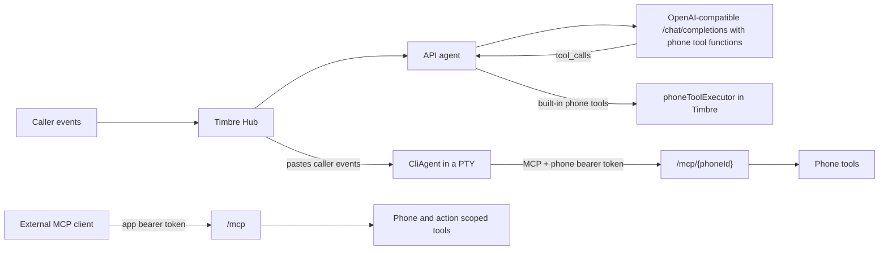

# How agents talk to Timbre

Each phone uses one configured agent. Caller events go through the Hub to that agent; the return path depends on the agent type.

## OpenAI-compatible API model

1. In **Agent**, add or choose an API model and enter its OpenAI-compatible base URL, model, and optional API key.
2. Assign the model to a phone and save. Timbre offers that mode's phone tools as function definitions and executes built-in tool calls in-process.

## Claude Code or another CLI

1. In **Agent**, choose the Claude Code preset or configure a CLI command and arguments.
2. For a custom CLI, put `{mcpConfig}` or `{mcpUrl}` in its arguments. At launch Timbre fills the placeholders and writes a per-phone MCP config containing that phone's bearer token.
3. Timbre runs the CLI in a PTY and pastes caller events into it. The CLI calls phone tools at `/mcp/{phoneId}` with the phone token.

## External MCP client

1. Open **Settings → Connected apps** and create an app token scoped to the phone and allowed actions.
2. Configure the client for `/mcp` with `Authorization: Bearer <app-token>`, or copy the setup snippet shown when the token is created.
