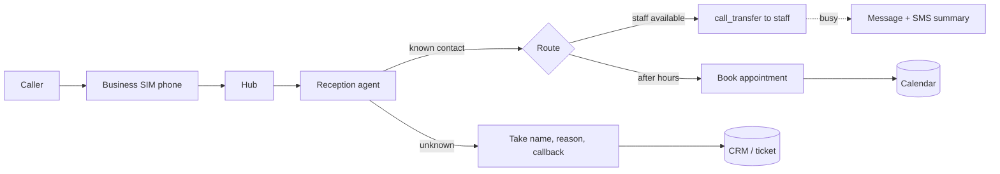

# Market research: where Timbre sits

Snapshot 2026-11-02. Open-source rows come from web search; commercial rows and prices are from general knowledge and have not been checked. Re-check them before quoting.

## Positioning

```mermaid
quadrantChart
    title Own number vs openness
    x-axis Closed / cloud --> Self-hosted / LLM-agnostic
    y-axis Rented or forwarded number --> Your own SIM
    quadrant-1 Timbre's space
    quadrant-2 Built-in screening
    quadrant-3 Cloud voice platforms
    quadrant-4 OSS voice stacks
    Timbre: [0.9, 0.92]
    CallRelay: [0.8, 0.8]
    textbee / Simhook (SMS only): [0.75, 0.7]
    Google Call Screen: [0.15, 0.9]
    Truecaller / Hiya: [0.2, 0.8]
    Vapi / Retell / Bland: [0.35, 0.2]
    Rosie / Goodcall / Smith.ai: [0.1, 0.25]
    Pipecat / LiveKit / Vocode: [0.85, 0.15]
    Phony (Twilio MCP): [0.7, 0.1]
```

## Closest alternatives

| Name | Type | Own SIM | Self-hosted | LLM-agnostic / MCP | Price |
|---|---|---|---|---|---|
| [CallRelay](https://glama.ai/mcp/servers/highsierraloft/callrelay/tree) | Spare Android phone over USB/ADB + SIP, MCP | Yes | Yes | MCP; mostly the AI placing calls | Free |
| [textbee](https://glama.ai/mcp/servers/y4272v18o4) + MCP | Android SMS gateway | SMS only | Yes | MCP | Free / hosted |
| [Simhook](https://mcpmarket.com/server/simhook) | Go server + Android app | SMS only | Yes | MCP | Free |
| httpSMS / SMSGateway | Android SMS-to-API | SMS only | Partly | REST | Free / cheap |
| [Phony](https://lobehub.com/es/mcp/sackio-phony) | Voice + SMS through Twilio + OpenAI Realtime | No | Yes | MCP, OpenAI only | Twilio usage |
| [Autodial](https://github.com/ProphetDiceBot/autodial), [AIReceptionist](https://github.com/Ding-Fan/AIReceptionist) | Open-source phone bots | No (SIP/Twilio) | Yes | Ollama/OpenAI | Free + phone line |
| Pipecat / LiveKit Agents / Vocode | Voice-agent frameworks | No | Yes | Any LLM | Free + phone line |
| Google Call Screen / Truecaller AI / Hiya | Call screening | Yes | No | No | Free to ~$5/mo |
| Vapi / Retell / Bland / Synthflow | Cloud voice agents | No | No | Bring your own LLM | ~$0.05–0.15/min |
| Rosie / Goodcall / Smith.ai / Quo / Dialpad | Business AI receptionists | No (forwarding) | No | No | ~$50–300/mo |

## The gap Timbre fills

- Voice and SMS, in and out, on your **real personal number**. No carrier change and no Twilio.
- Self-hosted and LLM-agnostic. Using a CLI coding agent (Claude Code/Codex) as the brain of a call looks unique.
- MCP both ways. One phone tool list serves the phone agent, and external agents can text or call through the app MCP.
- Personal-use features in one place: PIN caller verification, owner take-over, listen-in, contacts, call log.

## Risks

- **Android limits.** Call-audio access and the default-dialer role vary by OEM and Android version. Play Store policy restricts SMS and call-log permissions, so the app may need sideloading.
- **Legal.** Recording-consent laws, AI-disclosure rules (the FCC applies the TCPA to AI voices), and carrier terms for automated use of consumer lines.
- **Security.** An agent holding your real number attracts prompt injection and toll fraud. Keep PIN gating and `untrusted()` phone text.
- **Market.** Self-hosters with a spare Android phone are a small niche, and Google/Apple keep extending screening. Watch CallRelay most closely.

## What Reddit says

Weak evidence: reddit.com blocked fetching, so this comes from search snippets, Reddit mirrors and vendor blog summaries.

- Someone on Reddit asked for an MCP that calls a utility company, gets through the phone menu, then hands the call back to the user. Nobody pointed to a ready-made tool. Timbre's outbound call agent plus owner take-over does exactly this.
- Small businesses are split on AI receptionists. The main complaints: off-script or upset callers, noisy lines, **no way to reach a human for urgent calls**, and paid minutes that expire unused.
- Self-hosted voice projects people mention: AVA (Asterisk + Ollama), VoiceCortex (faster-whisper + Ollama + Piper). Both need a SIP line, not your own SIM.
- Own-SIM projects (textbee, Simhook, SMS Gateway for Android) handle SMS only.

## Reference: Booking.com AI Voice Support

Launched October 2025 (English and German lines). It looks up the caller's booking, makes changes, and hands off to a human with full context. Booking.com calls it in-house; no vendor has been named publicly ([Hospitality Net](https://www.hospitalitynet.org/news/4129287.html)).
## Turning Timbre into a business receptionist

What exists today versus what a receptionist product needs:



| Need | Today | Change |
|---|---|---|
| Greeting, screening, intake | Reception + persona | Business persona templates (hours, FAQ, services) |
| Transfer to a person | `call_transfer`, owner take-over | Staff directory and availability rules (hunt group) |
| Booking | MCP client servers (Agent → MCP) | Nothing in core: add a calendar MCP server (Google/Outlook/Cal.com) |
| CRM / tickets | MCP client servers | Nothing in core: add a CRM MCP server; persona asks for a post-call summary |
| Several numbers / staff | One agent per phone, isolated | Multi-phone dashboard, shared knowledge base, roles |
| After-hours behaviour | — | Schedule-based persona and routing |
| Compliance | PIN, untrusted text | AI disclosure on answer, recording consent, retention policy |
| Scale | One SIM = one concurrent call | Keep personal/SMB scale; above that use a SIP trunk |

Integrations (booking, CRM, knowledge base) are just MCP servers that the agent connects to. What actually needs core work is routing: staff transfer rules, an after-hours schedule, and the AI disclosure on answer.

The main constraint: one Android SIM handles one call at a time. Timbre works as a receptionist for a sole trader or a small office. A busy front desk would need a SIP/PBX backend behind the same agent and tool layer.
